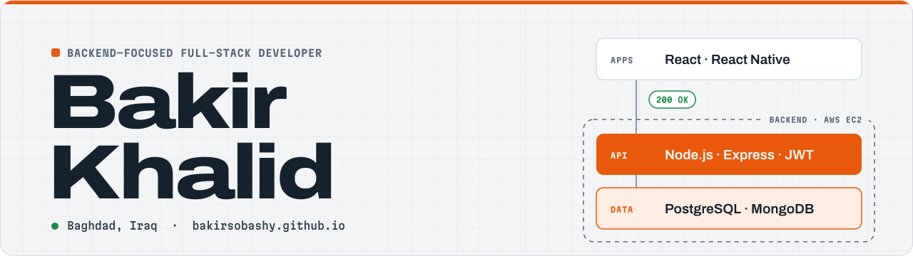

<picture>
  <source media="(prefers-color-scheme: dark)" srcset="assets/header-dark.svg">
  
</picture>

I build REST APIs with **Node.js, Express and PostgreSQL**, deploy them on **AWS**, and ship the React and React Native apps that use them.

At **Al Buraq Development Studio** I'm a junior backend developer: my APIs handle **10,000+ requests a day at 99.5% uptime**, running on EC2 behind Nginx with PM2. I'm also the lead programmer on our Godot games.

**Open to new roles** · remote, Baghdad, or relocation to Europe

[Portfolio](https://bakirsobashy.github.io) · [CV (PDF)](https://bakirsobashy.github.io/assets/bakir-khalid-cv.pdf) · [LinkedIn](https://www.linkedin.com/in/bakir-sobashy-aa6536378) · [Email](mailto:bakir1998bt.bk@gmail.com)

## Selected work

**[Kursi](https://github.com/bakirsobashy/kursi)** · open source ·   
Event booking REST API that never oversells: 50 people booking a 10-seat event at once get exactly 10 seats, because each booking is one conditional SQL `UPDATE`. Rotating refresh tokens, OpenAPI docs generated from Zod schemas, and 242 tests against a real PostgreSQL.  
Node.js · TypeScript · Express 5 · PostgreSQL · Drizzle ORM · Vitest · Docker

**[Budgi](https://play.google.com/store/apps/details?id=com.sobashy.Budgi)** · live on Google Play  
Offline-first personal finance app with spending categories, monthly and per-category budgets, and progress bars for what's left.  
React Native · TypeScript · Expo · SQLite · Drizzle ORM

**[Swap-War](https://github.com/bakirsobashy/swap-war)** · [play in the browser](https://bakirsobashy.github.io/swap-war/) ·   
2D physics brawler where teams re-shuffle every 10 seconds. The AI fighters bake each arena's tiles into a graph of platforms and jumps, plan routes with A\*, and pick goals with a six-state machine. 14 headless test scripts play real matches in CI, and every push deploys the web build.  
Godot 4.7 · GDScript · A\* pathfinding · GitHub Actions · WebAssembly

**Inventory Control** · client project  
Role-based inventory system built in cooperation with the Iraqi Ministry of Health, used daily by 50+ staff across several locations.  
Node.js · Next.js · PostgreSQL · JWT · AWS

**[MapTY](https://github.com/bakirsobashy/MapTY)** · [live demo](https://maptygeoapp.netlify.app)  
Log runs and bike rides on a map using your location; workouts persist in the browser.  
JavaScript · Leaflet · Geolocation API

Code for private projects is available on request, and I'm happy to walk through the architecture in an interview.

## Stack

Also comfortable with MySQL, Redis, Tailwind CSS, Python, C# and GDScript.

## Background

I studied pharmacy, then moved into software through Harvard's CS50 and full-stack bootcamps. I speak Arabic and English.
